# REPIT

iPhone-App für **Halbmarathon-Training und Muskelaufbau**. Sie verbindet
Krafttraining, Erholung, Schlaf, Ernährung und Körperwerte auf einem Gerät.
Alle Daten liegen lokal, ein Server ist nicht beteiligt. Die Gesundheitswerte
kommen aus Apple Health.

Gebaut mit Flutter (Cupertino), die Rechnungen liegen in einem reinen
Dart-Paket.

*Ein kurzes Video, das durch die App führt, kommt an diese Stelle.*

> Alle Bildschirmfotos zeigen **erfundene Demo-Daten** aus dem Simulator.

<table>
  <tr>
    <td>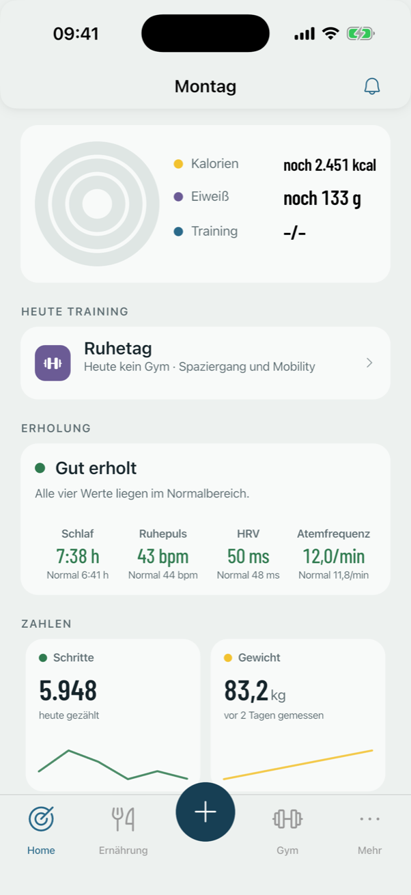</td>
    <td>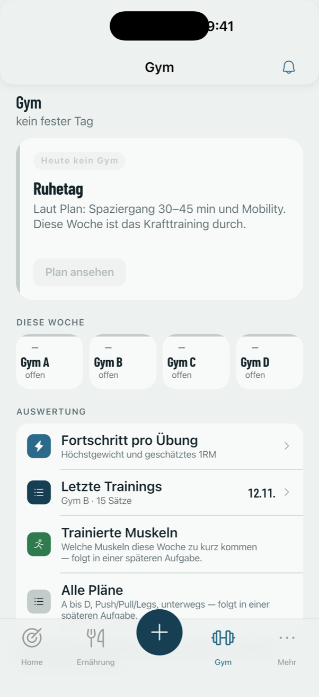</td>
    <td>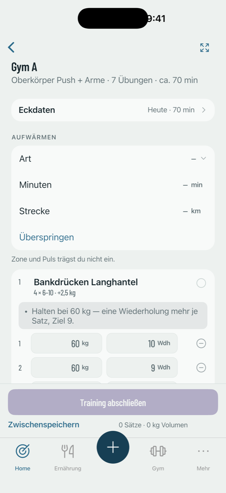</td>
    <td>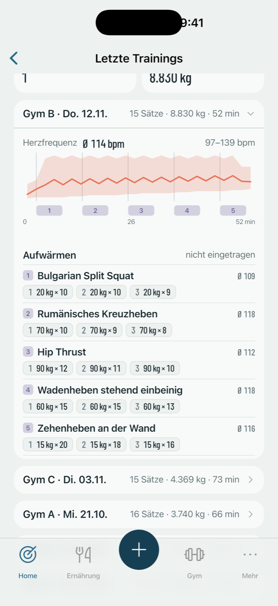</td>
  </tr>
  <tr>
    <td align="center">Home</td>
    <td align="center">Gym</td>
    <td align="center">Training eintragen</td>
    <td align="center">Letzte Trainings</td>
  </tr>
  <tr>
    <td>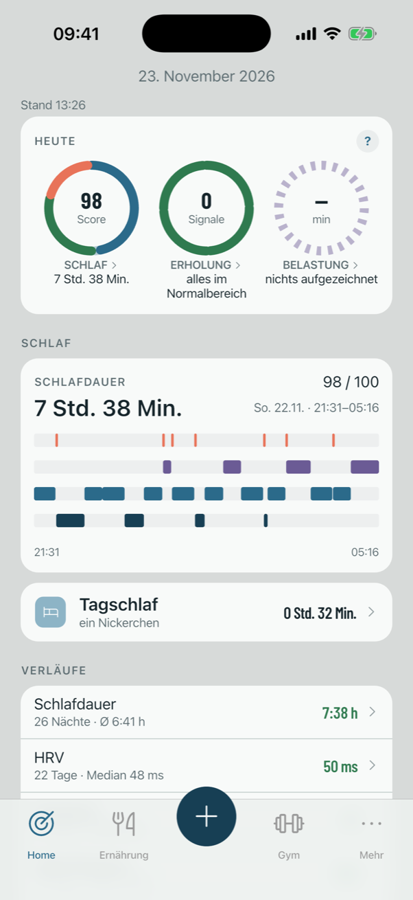</td>
    <td>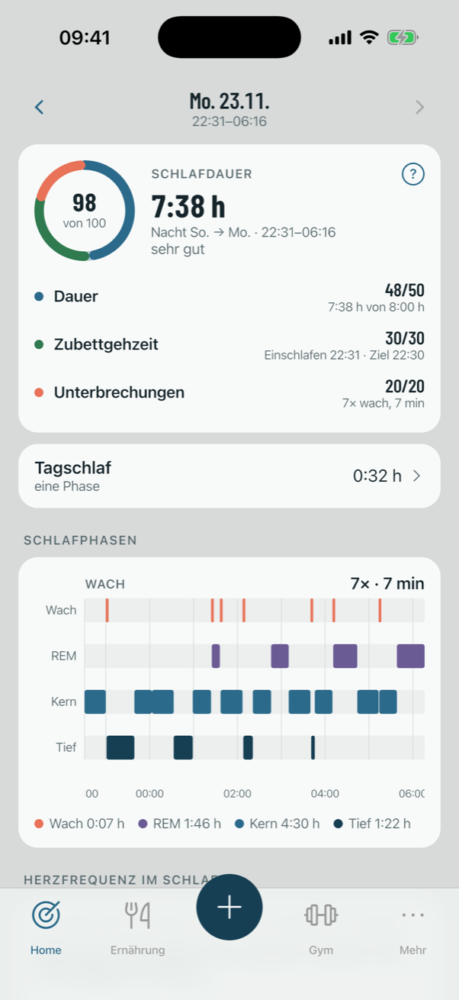</td>
    <td>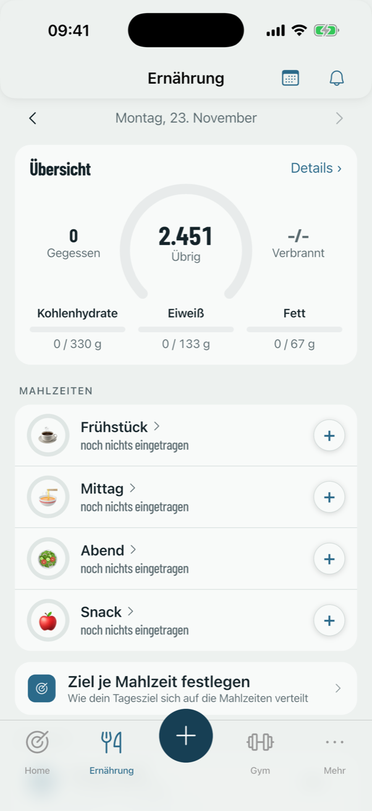</td>
    <td>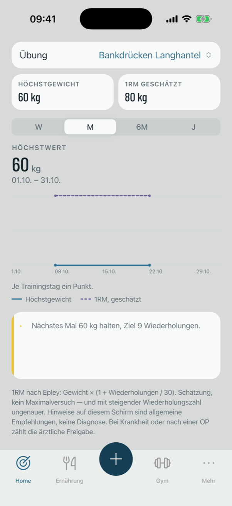</td>
  </tr>
  <tr>
    <td align="center">Erholung</td>
    <td align="center">Schlaf</td>
    <td align="center">Ernährung</td>
    <td align="center">Fortschritt pro Übung</td>
  </tr>
  <tr>
    <td>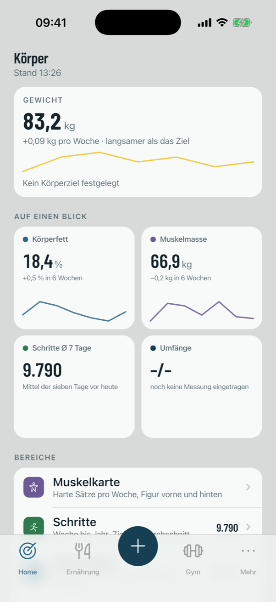</td>
    <td>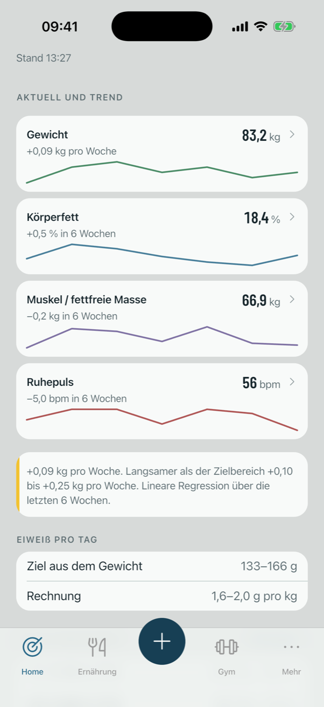</td>
    <td>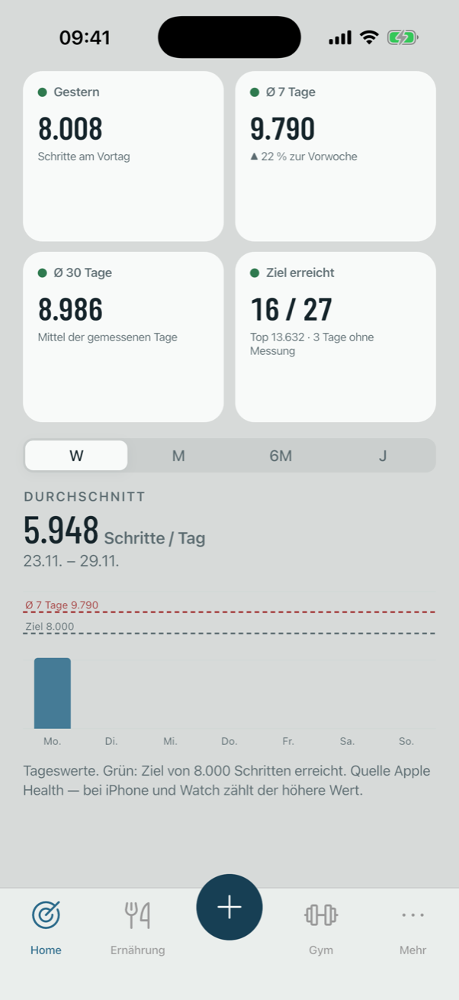</td>
    <td>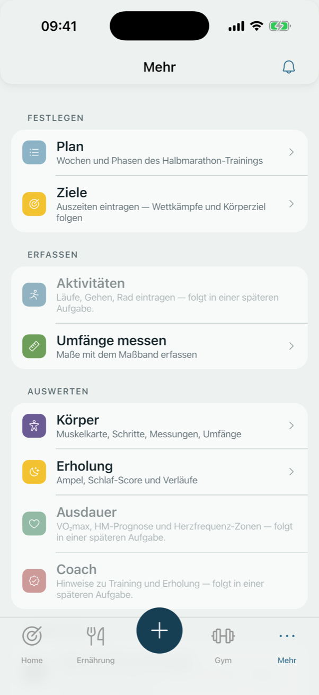</td>
  </tr>
  <tr>
    <td align="center">Körper</td>
    <td align="center">Messungen</td>
    <td align="center">Schritte</td>
    <td align="center">Mehr</td>
  </tr>
</table>

## Was die App kann

Die App hat vier Tabs (**Home**, **Ernährung**, **Gym**, **Mehr**) und in der
Mitte einen Knopf **+** zum schnellen Erfassen: Tippen öffnet den
Barcode-Scanner, langes Drücken öffnet ein Menü mit Suche und Barcode.

### Home

- Drei Ringe: Kalorien, Eiweiß und Training für heute.
- Das heutige Training: geplant, angefangen, erledigt, Ruhetag oder Pause.
- Erholung als Ampel mit Schlaf, Ruhepuls, HRV und Atemfrequenz, jeweils
  gegen den eigenen Normalbereich.
- Kacheln für Schritte und Gewicht, jede mit Kurzverlauf.

### Gym

- Wochenrotation **Gym A–D**, dazu frei wählbare Einheiten **Push / Pull / Legs**
  aus einem festen Übungskatalog.
- Eine Karte für den heutigen Zustand: *Training starten*, *Weiter eintragen*,
  eine Einheit vorziehen, Ruhetag oder Pause.
- **Training eintragen:**
  - Aufwärmen
  - Sätze mit Gewicht und Wiederholungen
  - Pausentimer
  - Anleitung „So geht's“ mit Übungsbildern
  - Vollbildmodus zum Durchwischen
  - Entwürfe überleben einen Neustart
- **Letzte Trainings** mit Satz- und Volumenstatistik. Zu jedem Training gibt
  es den Herzfrequenzverlauf aus dem passenden Apple-Health-Workout.
- **Fortschritt pro Übung:**
  - Höchstgewicht und geschätztes 1RM (Epley) als Diagramm
  - Vorschlag für die nächste Steigerung
  - Hinweis bei einem Plateau

### Erholung und Schlaf

- Tagesübersicht mit Schlaf-Score, Warnsignalen und Trainingsbelastung der
  Woche.
- Warnsignale gegen den eigenen Median: Ruhepuls zu hoch, HRV zu niedrig,
  Atemfrequenz zu hoch, Schlaf zu kurz.
- **Schlaf:**
  - Score mit Herleitung
  - Hypnogramm der Schlafphasen
  - Vitalwerte der Nacht
  - Verlauf über Woche, Monat, 6 Monate und Jahr
  - Monatskalender
- **Tagschlaf** getrennt von der Nacht. Nächte und Nickerchen lassen sich auch
  von Hand eintragen.
- Verläufe für Schlafdauer, HRV, Ruhepuls und Atemfrequenz.
- Belastung: Trainingsminuten der Woche gegen das Ziel.

### Ernährung

- **Tagesansicht:** Übersichtsring, Makros und vier Mahlzeiten mit eigenem
  Ziel je Mahlzeit.
- **Erfassen:**
  - Suche in eigenen Lebensmitteln und in
    [Open Food Facts](https://world.openfoodfacts.org)
  - Barcode-Scanner (Apple Vision)
  - Eigene Lebensmittel anlegen
  - Portionen wählen
- **Fotoschätzung per KI** (optional): ein Foto der Mahlzeit, Google Gemini
  schätzt Mengen und Nährwerte. Vor dem Buchen wird alles im Prüfblatt
  bestätigt oder korrigiert, ohne Tippen wird nichts gebucht. Den API-Schlüssel
  trägst du selbst ein; er liegt nur im iOS-Schlüsselbund.
- **Wasser** mit Tagesziel aus dem Körpergewicht.
- **Kalorienziel mit Herleitung:**
  - Grundumsatz + Aktivität + Zuschlag aus dem Körperziel
  - pausiert bei OP-Erholung, Krankheit oder Verletzung
- Verlauf der letzten 14 Tage und ein Monatskalender mit Ring je Tag.
- Gebuchte Mahlzeiten werden als Nährwerte nach Apple Health geschrieben.
- **Live-Aktivität** auf dem Sperrbildschirm: ein Ring je Mahlzeit und eine
  Serie. Ein Tipp darauf führt direkt ins Erfassen.

### Körper

- Gewicht, Körperfett, fettfreie Masse und Ruhepuls mit Trend über 6 Wochen.
- Körperfett-Schätzung nach der Navy-Methode als Gegenprobe zur Waage.
- Eiweißziel aus dem Gewicht.
- Gewicht von Hand eintragen; der Wert wird nach Apple Health geschrieben.
- **Umfänge:**
  - 15 Maße mit dem Maßband erfassen
  - Verlauf je Maß, links und rechts im Vergleich
- **Schritte:** Kennzahlen und ein Diagramm über Woche, Monat, 6 Monate und
  Jahr. Bei iPhone und Watch zählt der höhere Wert.

### Ausdauer

- VO₂max aus Apple Health mit Einordnung und Verlauf.
- Halbmarathon-Prognose daraus.
- Erholungspuls als zweiter Formindikator — er fließt **nicht** in die
  Erholungs-Ampel ein.
- Herzfrequenz-Zonen nach der Herzfrequenzreserve (Karvonen, dieselbe
  Methode wie die Apple Watch), dazu die Verteilung der Laufzeit auf die
  Zonen und eine Anleitung, wie man die Zonen auf der Watch einstellt.
- Die Kadenz steht noch leer: Die Schrittfrequenz je Lauf liefert der
  Health-Kanal bisher nicht.

### Ziele und Auszeiten

- Auszeiten anlegen: OP-Erholung, Krankheit, Verletzung oder Urlaub.
  OP-Erholung, Krankheit und Verletzung pausieren das Training und den
  Kalorienzuschlag.
- Zielgewicht, Kalorienziel und Zieldatum (vorläufige Eingabe).

### Daten übernehmen

- Import von Gym-Trainings und Umfängen aus der Exportdatei der Vorgänger-App.
  Es wird nur ergänzt, nie überschrieben oder gelöscht.

### Noch nicht fertig

In der App sichtbar, aber noch ohne Funktion:

- Trainingsplan mit Wochen und Phasen
- Wettkampfziele
- Lauf-Aktivitäten
- Coach
- Muskelkarte
- Rezepte und Einkauf
- Hinweise unter der Glocke

## Apple Health

Gelesen werden:

- Schritte, aktive und Ruheenergie
- Ruhepuls, HRV, Atemfrequenz, VO₂max, Herzfrequenz
- Gewicht, Körperfett, fettfreie Masse, Größe, Geburtsjahr
- Trainingsminuten, Stehstunden
- Schlafphasen
- Workouts
- Alkohol
- Nährwerte aus anderen Apps

Geschrieben werden nur das **Gewicht** und die **Nährwerte** gebuchter
Mahlzeiten.

Fehlende Werte erscheinen nie als „0“. Eine Anzeige ohne Daten bleibt in
derselben Form stehen und zeigt `–/–`, statt zu verschwinden oder „nichts
getan“ zu behaupten.

## Daten und Netz

- Alle Daten liegen in einer lokalen SQLite-Datenbank (drift) auf dem Gerät.
  Es gibt kein Konto und keinen Server.
- Ins Netz gehen nur zwei Dinge:
  - Suchanfragen und Barcodes an Open Food Facts
  - Fotos an Google Gemini, und das nur, wenn du die Fotoschätzung mit einem
    eigenen Schlüssel einschaltest

## Aufbau

| Ort | Inhalt |
|---|---|
| `app/` | Flutter-App: Oberfläche, Provider (Riverpod), lokaler Cache (drift) |
| `app/ios/Runner/` | Swift-Plattformkanal zu HealthKit, Schlüsselbund und Live Activity |
| `Packages/trainings_core/` | Alle Rechnungen in reinem Dart, ohne Flutter |
| `Packages/TrainingsCore/` | Swift-Paket, das der HealthKit-Kanal einbindet (Berliner Tagesgrenzen, Zusammenführung der Schrittquellen) |
| `scripts/exercises-*.mjs` | Lädt die RepDB-Übungsdaten, siehe unten |

`trainings_core` importiert ausschließlich `dart:core` und `dart:math`. Ein
Test erzwingt das (`test/import_boundary_test.dart`). Jede Formel hat dort
einen Test ohne Mocks: Daten rein, Daten raus.

### Technik

- Flutter ≥ 3.47, Dart ^3.13.5, iOS 17+
- Oberfläche: Cupertino, `liquid_glass_widgets`, `fl_chart`
- Zustand: `flutter_riverpod`
- Speicher: `drift` (SQLite)
- Kamera: `mobile_scanner` (Barcode), `camera` (KI-Foto)
- Schriften: Barlow Condensed, Source Sans 3, Phosphor Icons

## Bauen und testen

**Zwei Datensätze liegen nicht im Repository** — bei beiden erlaubt die
Lizenz keine Weitergabe als Datei. Mitgeliefert sind die Werkzeuge, die sie
bauen; beide müssen einmal vor dem ersten Bauen laufen.

**Übungsbilder und -daten von RepDB.** Ein Skript lädt sie vom festgelegten
RepDB-Stand nach `app/assets/exercises/`. Braucht nur Node 18 oder neuer:

```bash
node scripts/exercises-asset.mjs
```

**Die Lebensmittel-Seed-Datenbank.** Sie mischt den Bundeslebensmittel-
schlüssel 4.0 (Max Rubner-Institut, kostenfrei, Zitierweise im README des
Werkzeugs) mit den populärsten deutschen Produkten aus Open Food Facts
(ODbL). Weil die ODbL für eine abgeleitete Datenbank Share-Alike verlangt
und die BLS-Seite keine Lizenz benennt, lässt sich die Vereinbarkeit beider
in **einer** Datei nicht belegen — darum wird sie lokal gebaut, nicht
weitergegeben. Anleitung in
[`scripts/ernaehrung-seed/README.md`](scripts/ernaehrung-seed/README.md):

```bash
brew install duckdb
scripts/ernaehrung-seed/seed-bauen.sh --off-anzahl 20000   # ohne BLS
```

Ohne sie startet die App, die Suche in eigenen Lebensmitteln bleibt dann
leer — Open Food Facts wird weiter online abgefragt.

```bash
# Kern
cd Packages/trainings_core && dart test

# App, Widget-Tests eingeschlossen
cd app && flutter test

# Statische Prüfung (inkl. riverpod_lint)
cd app && dart analyze lib

# Im Simulator starten
cd app && flutter run -d <simulator-udid>
```

Für ein eigenes Gerät braucht es zweierlei:

```bash
cd app/ios/Flutter
cp Signierung.xcconfig.beispiel Signierung.xcconfig   # eigene Team-ID eintragen
```

Die Datei steht in `.gitignore` und wird nie committet — mehrere Leute bauen
an diesem Projekt, möglicherweise mit verschiedenen Apple-Teams, und in der
versionierten Projektdatei überschriebe der Wert sich gegenseitig. Ohne die
Datei baut das Projekt weiter, es lässt sich nur nicht signieren.

Dazu der Bundle-Identifier in `app/ios/Runner.xcodeproj`: Er ist je
Apple-Team eindeutig, `de.rosenbach.repit` lässt sich also nicht übernehmen.

## Grenzen

Die App ist für ein kostenloses Apple **Personal Team** gebaut. Daraus folgt:

- Die Signatur hält 7 Tage, danach muss die App neu installiert werden.
- Kein iCloud/CloudKit, kein Push, keine App Groups und damit keine Widgets,
  die App-Daten lesen.
- Kein HealthKit Background Delivery.

Die Live-Aktivität kommt ohne Push aus.

## Quellen und Danksagung

- Übungsdaten und -bilder: **Exercise data by RepDB ([repdb.co](https://repdb.co))**.
  Nur zur Nutzung in der App, nicht als Datensatz weiterzugeben. Die Lizenz
  legt das Ladeskript nach `app/assets/exercises/LICENSE-DATA.md`.
- Lebensmitteldaten: [Open Food Facts](https://world.openfoodfacts.org),
  Lizenz ODbL.

## Hinweis

Alle Trainings-, Ernährungs- und Gesundheitswerte der App sind **allgemeine
Empfehlungen und Schätzungen**, keine medizinische Beratung und keine
Diagnosen. Nach einer Operation oder bei Krankheit gilt die ärztliche Freigabe.
